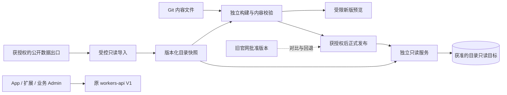

# CardScanFox 官网服务与数据隔离规格

> 2026-11-07 更新：按用户要求取消新增官网管理后台、CMS、角色权限和官网数据库。采用项目文件维护内容、独立构建和新增只读数据服务；新服务参考现有 App 表结构，旧服务代码不修改。本文件不授权远程部署、资源创建或正式域名切换。

配套文档：[主 Spec](../00-product/cardscanfox-website-redesign-spec.md)、[网址与文案](../05-delivery/cardscanfox-website-route-seo-spec.md)、[App 兼容 AI 执行版](../03-data-api/app-backward-compatibility-ai-guide.md)。

## 1. 实施范围

| 单元 | 作用 | 内容真源 |
| --- | --- | --- |
| `apps/marketing-web` | 原正式站、对比与回退基线 | 原生成链保持。 |
| `apps/cardscanfox-web` | 新版页面、导航、文章、SEO、独立预览与构建 | 受保护旧内容及新 Markdown/JSON 文件。 |
| `apps/website-service` | 官网独立只读查询 | 本地评审快照，或新增的 PostgreSQL 只读查询；真实模式按发布指针形成数据版本。 |
| `packages/website-content` | 官网共享数据、确定性查询和导入校验 | 获准公开的卡牌、价格和来源元数据。 |

不创建 `website-admin`，不建设 `/site-admin-api`，不新增官网账号或数据库，不改变现有业务 Admin。

## 2. 当前后端约束

- `apps/workers-api/src/data-source/routes.ts` 的 search/sets 接口需要查询或游戏条件，`total` 是本页长度。不能把它改成全库总量，也不能用它判断导入完整。
- market-prices 是 no-store；返回的 `updated_at` 是响应生成时间，不能用作价格观测日。
- price-series 旧接口支持的范围与权益逻辑保持原约定。官网只展示固定 30 天，不通过修改旧 V1 限制 App。
- 目录引用和完整卡号按字符串处理；合法零价与 null 区分。已发布价格才可导入，来源/指标/语言/工艺/品相不混用。
- 源码中残留的 D1 类型属于旧债务，本次不采用或扩展 D1。

## 3. 内容文件与更新

1. 46 个已知旧网址的线上正文已回收到独立站，包含原 checkout 缺少的 13 篇文章。旧路径、正文、表格、日期、引用和图片说明有独立基线。
2. 新文章用 Markdown 正文和显式 JSON 元数据。path 独立于标题，不自动改 slug。新内容不覆盖任何受保护旧地址。
3. 元数据包含 title、description、H1、分类、发表/修改日期、作者和来源；没有实际来源或作者资历时不伪造。
4. Markdown 仅生成受控 HTML。禁止脚本、事件属性、iframe、危险 URL 和任意 HTML 注入。
5. 草稿以 `published: false` 保留在项目中，不进入公开路由或 sitemap。评审通过后随 Git 和批准构建发布，不增加后台编辑器。
6. 受保护旧文的 SEO 草案继续单独保存；不能因构建或新文章登记自动替换旧高曝光标题和正文。

## 4. 公开数据与受控导入

来源优先选择已生成的授权公开导出；若选择现有后端接口，需确认接口地址、字段、完整分页、权限、读取预算和价格观测口径。

- 官网请求不按访客逐次访问 App API。导入任务单独执行，页面调用新服务的受限缓存读接口，不经过旧 App 请求链路。
- 导入只接受公开卡牌/系列/价格字段，不导入用户、会话、扫描原图、订单、Portfolio 或 Wishlist。
- 快照含 catalogVersion、capturedAt、来源、覆盖范围和完整性说明。当前 30 条 `review-snapshot` 不能直接作为生产全库。
- 旧 publicCardId/publicSetId 保持；改名和换图不产生新 ID。删除/停用必须有明确源标记，不把临时缺失解释为删除。
- 更新先校验数据和稳定路由，再生成完整构建。导入失败不得覆盖上一成功快照。
- 趋势只接受同一确认维度的固定 30 天窗口；缺口不补线，缺历史不填 0，不产生预测点。
- 全量规模超过当前静态构建或 Worker 容量时，明确失败并评估独立读模型。不能把截断数据声称为全库。

用户已确认新增服务并参考旧 App 后端，且不得修改旧代码。新服务的 PostgreSQL 查询已按现有表结构实现；真实只读目标、独立凭据和远程绑定仍未配置。本地快照和隔离引擎验证不能代替全量源联调证据。

## 5. 只读接口

独立服务前缀 `/site-api/v1`，不挂接旧业务写接口。

| 方法与路径 | 职责 |
| --- | --- |
| `GET /health` | 只读服务状态和数据版本。 |
| `GET /games` | 本版本实际覆盖的游戏。 |
| `GET /cards` | 名称、游戏、系列、语言、工艺、价格状态、排序和分页。 |
| `GET /cards/{id}` | 印次和可用参考价。 |
| `GET /cards/{id}/trend` | 固定 30 天趋势；任意更长窗口明确拒绝。 |
| `GET /sets`、`GET /sets/{id}` | 系列身份、覆盖说明和稳定分页。 |
| `GET /prices` | 带日期的参考价概览。 |

只允许 GET/HEAD。公开响应带 requestId、catalogVersion、snapshotCapturedAt、datasetMode。分页 total 只指快照内可精确计算数量，并包含 returnedCount、hasMore、nextPage。无结果是 200，非法参数是 400，真实不存在是 404，服务故障是 503；不以空数据掩盖失败。

## 6. 构建、SEO 与回退

- 一次构建输出 HTML、资源、保护路由、内容哈希、数据版本和发布清单，组成不可拆分的交付物。
- 预览有认证、noindex/no-store，不发布 sitemap，不提交 IndexNow。robots 不能代替认证。
- 正式构建只为已确认允许收录的 canonical 页面生成 sitemap。Saved、草稿、任意查询组合、空分类和不存在页不进入。
- 新增目录的索引逐批显式开放；旧 46 页不因新模板默认策略被删除或无故 noindex。
- 预览与正式模式必须匹配配置和构建。不能把预览的 noindex/认证带到正式站，或把评审数据直接公开为完整卡库。
- 回退使用批准的完整版本。差异检查必须拒绝会删除既有或后来已发布 URL 的回退，不回滚业务数据库。
- 对正式 Host 的切换需先回读 Workers Route、Custom Domain、DNS、旧自动发布和缓存规则；保持原域名和路径。

## 7. 隔离与安全

公网流量只经独立官网服务读取公开目录，使用独立只读连接、查询预算和 60 秒内部缓存；优先只读副本。旧 V1、App 账号、购买、扫描、价格发布指针、Apple 调度及原 Admin 不依赖新站。

不共享业务写凭据、数据库连接池、认证令牌或重试队列。新站失败时显式报错，不自动转发到生产 API。素材来自许可目录，不使用用户扫描原图；内容文件和构建清单不得包含 Secret。

源数据许可、卡图再展示、预算、正式资源目标及统计隐私仍需在相应上线活动前确认。不给未实施的资源或外部验收标记通过。

## 8. 验收与交付

完成开发和文档后，只验证官网、只读服务、文件导入、内容保护、构建和实际共享调用方。

- 旧地址和正文完整保留，新文章不能覆盖旧页。
- 元数据、安全清洗、草稿排除、分类、分页、自指 canonical 和真实 404 正确。
- 数据零值/null、语言/工艺/价格维度、固定 30 天和旧日期可区分；失败不替换成功快照。
- 预览访问控制和正式构建门槛正确；发布清单与路由/资源相符。
- 新旧站可对比；正式部署、域名切换、抓取与索引是独立结果。

远程资源创建、Git push、部署、迁移和域名切换需对应明确授权。未改旧业务代码时，不把无关 App 全量回归作为本期任务。
